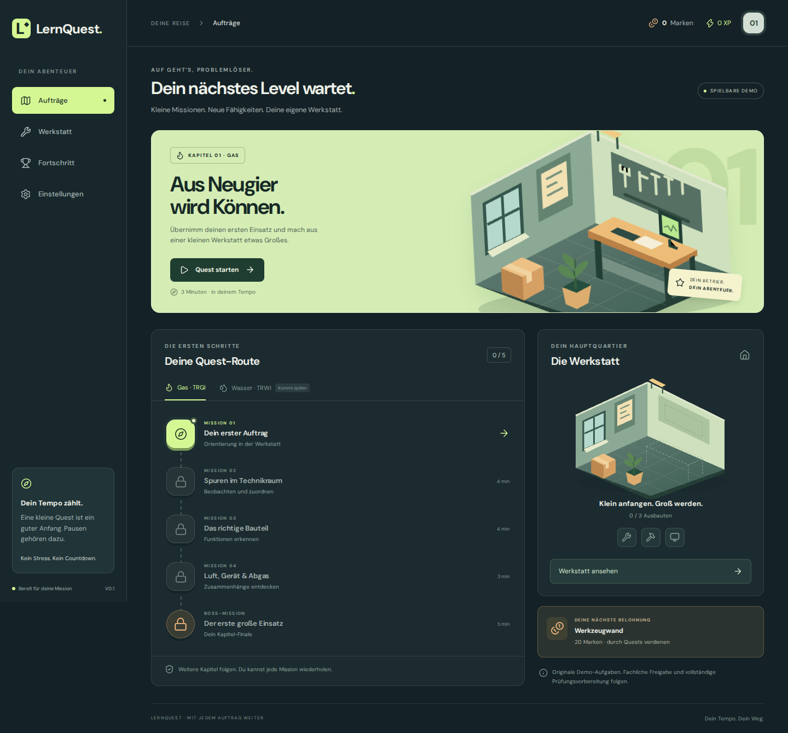

# LernQuest · Deine Werkstatt. Deine Missionen.

Eine installierbare PWA, die Quest-Abenteuer und Werkstattaufbau verbindet. Langfristiges Ziel: spielerische Vorbereitung auf TRGI und TRWI im Umfeld der HWK Düsseldorf.

**Version 0.1 ist eine spielbare Kapitel-Demo.** Sie enthält 22 eigenständig formulierte Demo-Aufgaben in vier TRGI-Einstiegsquests und einer Boss-Mission. Fachliche Freigabe, weitere Kapitel, Rechenaufgaben, TRWI-Inhalte und ein authentischer Prüfungsmodus stehen noch aus. Die App ist kein offizielles Angebot der HWK oder des Landesinstallateurausschusses und zeigt keine Prüfungsreife an.



## Spielen

1. Einen Auftrag auf der Karte starten.
2. Fragen beantworten, Befunde in einer symbolischen Szene auswählen oder Schritte ordnen.
3. Erklärungen lesen und bei Bedarf Hinweise nutzen.
4. XP und Werkstattmarken verdienen.
5. Werkzeugwand, Profi-Werkbank und Diagnoseplatz freischalten.

Normale erste Questabschlüsse bringen 100 XP und 20 Marken, die Boss-Mission 200 XP und 40 Marken. Die drei Ausbauten kosten 20, 40 und 60 Marken. Freies Wiederholen bleibt jederzeit möglich, ohne erneut die Erstabschluss-Belohnung zu vergeben. Spielerlevel: 1 + abgerundete Gesamt-XP / 200.

Pausen kosten nichts. Es gibt keinen Countdown, keine Leben, Lootboxen oder Käufe. Ton ist standardmäßig aus; Animationen lassen sich reduzieren. Jede Auswahl wird gespeichert. Auch die Reihenfolge-Aufgaben funktionieren per Tastatur oder Tippen.

## Lokal starten

Node.js **22.12 oder neuer** (getestet mit Node 24):

```bash
npm ci
npm run dev
```

Die angezeigte lokale Adresse im Browser öffnen. Für eine Produktionsvorschau einschließlich Service Worker:

```bash
npm run build
npm run preview
```

Offline-Nutzung funktioniert nach dem ersten erfolgreichen Laden der Produktionsversion. Installation benötigt HTTPS oder localhost. Auf dem iPhone: Safari → Teilen → Zum Home-Bildschirm. Ein echter iPhone-/Safari-Gerätetest steht noch aus.

## Spielstand

Der Spielstand liegt ausschließlich in IndexedDB auf dem aktuellen Gerät. Ein Konto, Backend, Tracking oder KI-Dienst wird nicht benötigt. Es gibt noch keine automatische Gerätesynchronisation.

Unter Einstellungen lässt sich der Stand als JSON exportieren. Beim Import wird die Datei geprüft, eine Vorschau angezeigt und erst nach Bestätigung der vorhandene Stand ersetzt. Browserdaten können vom Browser oder Nutzer gelöscht werden: regelmäßig exportieren.

Belohnungen und Käufe werden in einer atomaren Transaktion gespeichert. Browser-Neuladen oder doppelte Abschlussereignisse dürfen Belohnungen nicht vervielfachen. Updates werden angeboten und während einer laufenden Mission nicht aktiviert.

## Fachlicher Fortschritt

Spiellevel und Fachwissen bleiben getrennt. **Alle aktuellen Aufgaben haben Status `demo` und erzeugen keinen fachlichen Beherrschungsnachweis.** Der Lernalgorithmus ist für später freigegebene Inhalte vorbereitet: verschiedene Aufgabenvarianten in getrennten Sessions an unterschiedlichen Tagen, Hinweise zählen nicht als selbstständiger Erfolg, Wiederholungsintervalle 1/3/7 Tage. Er wird in Unit-Tests geprüft.

Inhaltsschema: `src/game/types.ts`; Demo-Inhalte: `src/game/content.ts`. Aufgaben enthalten Lernziel, Bewertungsregel, Erklärung, Quellenhinweis, Status und Inhaltsversion. Vor fachlicher Freigabe müssen konkrete Fundstellen, Regelwerksstand und fachliche Prüfung dokumentiert werden. Es sind keine Originalfragen oder PDFs aus den hochgeladenen Kursunterlagen enthalten.

Themenorientierung:

- [HWK Düsseldorf: TRGI – Gastechnik](https://www.hwk-duesseldorf.de/artikel/trgi-gastechnik-31%2C0%2C539.html)
- [HWK Düsseldorf: TRWI – Wassertechnik](https://www.hwk-duesseldorf.de/artikel/trwi-wassertechnik-31%2C0%2C538.html)

Lehrgangsabschluss und LIA-Prüfung sind zu unterscheiden. Prüfungsformat, Bewertung und zulässige Hilfsmittel müssen für den späteren Prüfungsmodus bestätigt werden.

## Prüfen

```bash
npm test
npm run build
npx playwright install chromium
npm run test:e2e
```

Die Browser-Tests verwenden den zuvor erstellten Build. Sie prüfen Kampagne und Ausbauten, Fortsetzen nach Neuladen, Hinweise, Tastaturbedienung, mobile Darstellung, Importfehler und Offline-Neuladen. Der Workflow `.github/workflows/ci.yml` führt die Prüfungen auf GitHub aus; er veröffentlicht keine Website.

Optional kann in eingeschränkten Testumgebungen ein vorhandenes Chromium-Binary über `PLAYWRIGHT_CHROMIUM_EXECUTABLE_PATH` gesetzt werden. Die zusätzlichen Startflags gelten ausschließlich für diesen Testbrowser.

## Bereitstellung

`dist/` ist auf einem statischen HTTPS-Host auslieferbar. Die App ist noch nicht öffentlich bereitgestellt. Für einen Unterpfad wird vor dem Build `APP_BASE` gesetzt, beispielsweise:

```bash
APP_BASE=/trwi/ npm run build
```

Manifest, Service Worker und Asset-Pfade verwenden diesen Basis-Pfad. Diese Einstellung muss zur tatsächlichen Hosting-Adresse passen. React, TypeScript, Vite und `vite-plugin-pwa` bilden die technische Grundlage. Die Schrift DM Sans wird lokal gebündelt und offline gespeichert.

## Entwurf und weiterer Ausbau

- [Freigegebener Spielentwurf](docs/superpowers/specs/2026-11-02-lernquest-design.md)
- [Umsetzungsplan](docs/superpowers/plans/2026-11-02-lernquest-pwa.md)

Nächste fachliche Arbeit: Lehrbriefe vollständig auswerten, Lernziele mit konkreten Quellen verknüpfen, echte Rechenaufgaben entwickeln und fachlich freigeben. Danach weitere TRGI-Kapitel und TRWI ergänzen. Der erste Spieleinstieg ist bewusst ein kleiner, durchgängiger Ausschnitt.
